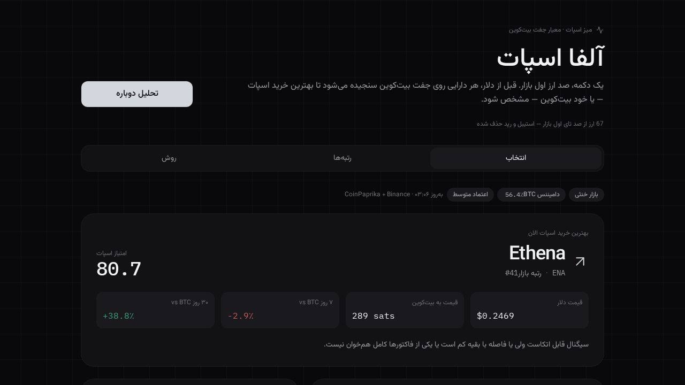
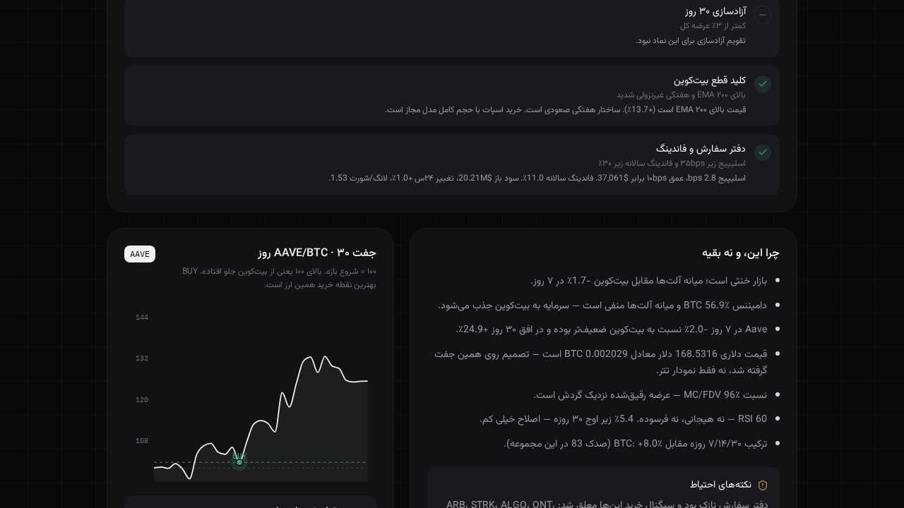
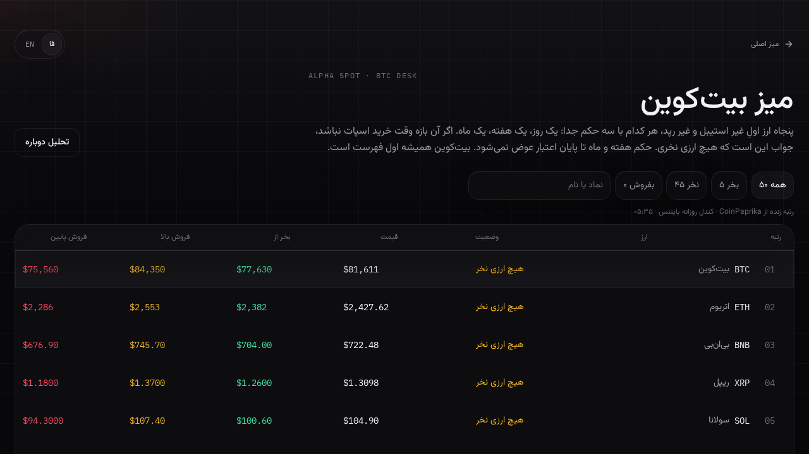
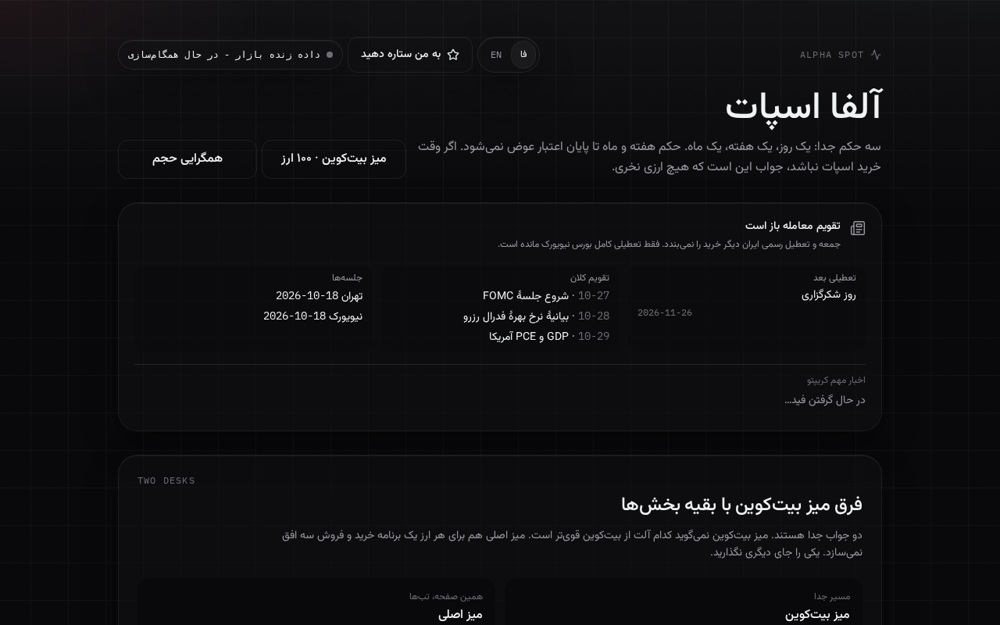

<div align="center">

# Alpha-Spot

**Live crypto spot desk. Rank alts against Bitcoin, size the position, or stay in BTC.**

[Live demo](https://alpha-spot-pk54.netlify.app/) · [Source](https://github.com/mahdisandughdaran-sys/alpha-spot)

Persian + English · RTL · Public market data only

</div>

> Not investment advice. Quotes come from CoinPaprika and Binance. Nothing is stored on the server.

Alpha-Spot is a right-to-left spot desk for people who measure altcoins **in Bitcoin**, not in headlines. One action ranks the liquid universe on the BTC pair and names a single spot idea — or Bitcoin itself when alts are weak.

## Features

- **Pick vs Bitcoin.** Score liquid coins on the BTC pair. One name comes back, with the reasons and a 30-day BTC chart. If the field is weak, Bitcoin wins.
- **Opportunity zones.** Names that are not a buy yet: the zone, what would confirm it, and what would invalidate it. Touching the price is not confirmation.
- **Position size.** `(capital × risk%) / stop%`, next to taker-buy flow and an estimated liquidation map.
- **Bitcoin desk.** Top 100 non-stable names. One buy, one sell-if-up, one sell-if-down. Stables stay out. Bitcoin stays first.
- **Macro clock.** Tehran and New York sessions, holidays, FOMC / GDP / PCE.
- **Backtest, with costs.** 10 bps fee and 8 bps slippage per side.

## Stack

React 19, TypeScript, Tailwind CSS, TanStack Start, Vite. Data: CoinPaprika and Binance. Deployed on Netlify.

## Screenshots






## Run it locally

Node.js 20+ and npm 10+.

​```bash
git clone https://github.com/mahdisandughdaran-sys/alpha-spot.git
cd alpha-spot
npm install
npm run dev
​```

Dev server: http://127.0.0.1:8080

## فارسی

آلفا اسپات میز اسپات راست‌به‌چپ است. هر دارایی روی جفت بیت‌کوین سنجیده می‌شود. اگر آلت‌ها ضعیف باشند، خود بیت‌کوین برنده است.

1. انتخاب — یک نام، دلیل‌ها، نمودار ۳۰روزه جفت BTC
2. فرصت‌ها — ناحیه، تأیید، ابطال
3. اندازه پوزیشن — (سرمایه × درصد ریسک) / درصد حد ضرر
4. میز بیت‌کوین — صد ارز اول، خرید، فروش بالایی، فروش پایینی
5. تقویم کلان — تهران، نیویورک، FOMC

این صفحه توصیه سرمایه‌گذاری نیست.

Made by [Mahdi Sandughdaran](https://github.com/mahdisandughdaran-sys).
